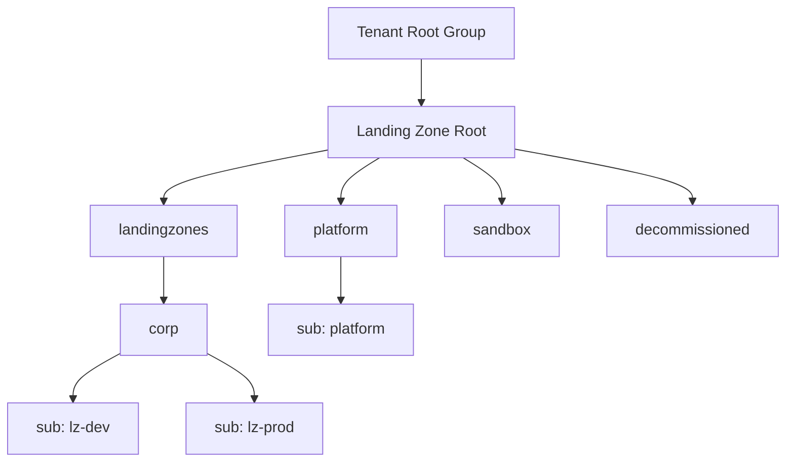
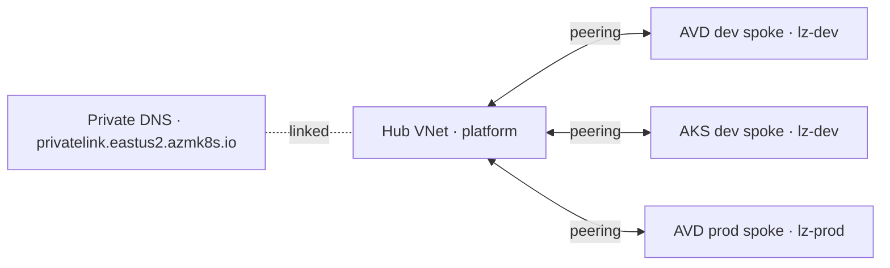

# Azure Landing Zone (Terraform)

An Azure landing zone built and operated entirely as code: governance, enterprise RBAC, hub-spoke networking across three subscriptions, an Azure Virtual Desktop workload promoted from dev to prod, and a private AKS cluster. Every change ships through GitHub Actions using OIDC federation; no cloud credentials are stored anywhere.

## Architecture

## What this deploys

| Layer | Implementation |
|---|---|
| Governance | Five management groups; three subscriptions placed by role; region allow-list (deny), corp public-IP deny, storage secure transfer (audit), authored tag policy (audit) |
| Identity and access | Entra security groups; custom *Landing Zone Operator* role; data-driven group assignments at management-group scope |
| Networking | Hub-spoke across three subscriptions; private subnets; NAT Gateway egress; central private DNS |
| Azure Virtual Desktop | Pooled Windows 11 multi-session; Entra-joined hosts; Entra single sign-on; dev → prod with an approval gate |
| AKS | Private API server; Azure CNI Overlay with Cilium; Entra RBAC; local accounts disabled |
| Delivery | PR validation (fmt, validate, tflint); plan then environment-gated apply on `main`; confirmed destroy |

## Delivery model

- Pull requests run validation only; no Azure token is ever issued to PR code.
- `main` plans each stack with a branch-scoped OIDC subject, then applies under an environment-scoped subject after approval for `platform` and `prod`.
- State is one blob per stack in Azure Storage, with Entra-only data-plane access, versioning and soft delete.

## Repository layout

| Path | Purpose |
|---|---|
| `bootstrap/` | One-time trust anchors: state storage, deploy identity, root management group, groups |
| `modules/` | Reusable building blocks |
| `stacks/` | Deployable units, applied in order 10 → 50 |
| `.github/workflows/` | CI, deploy, reusable stack workflow, destroy |
| `docs/adr/` | Architecture decision records |

## Releases

| Tag | Milestone |
|---|---|
| v0.1.0 | Governance baseline |
| v0.2.0 | Enterprise RBAC |
| v0.3.0 | Hub-spoke connectivity |
| v0.4.0 | AVD dev → prod |
| v0.5.0 | Private AKS |
| v1.0.0 | Documented, complete landing zone |

## Cost and teardown

Workload stacks are destroyed between sessions with the `destroy` workflow. Platform layers cost close to nothing while idle.